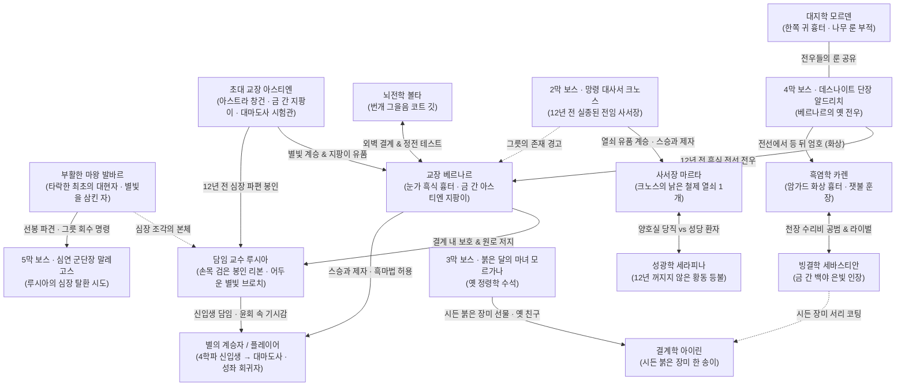

# 《마법학교 아스트라》 공식 세계관 바이블 (Official World Bible)

> **문서 지위**: 본 문서는 P5-1 ~ P5-4(세계관·연대기·메인 스토리 대확장·회귀 진실 루트·학파별 퀘스트라인 및 교내 일지)의 **단일 정사 기준(Single Source of Truth)**이다.  
> 모든 고유명사·인물 소품·장소·계급·마법 체계·사건 연대는 기존 게임 정사(`src/data/professors.ts`, `src/data/acts.ts`, `src/data/schools.ts`, `src/data/towerLords.ts`, `src/data/gearSets.ts`, `src/data/towerDepth.ts`)와 100% 일치한다.

---

## 1. 핵심 세계관 & 톤 가이드

### 1.1 장르 및 핵심 정체성
- **장르**: 다크 고딕 판타지 × 아카데미 성장 RPG × 건조한 블랙코미디.
- **시대의 전제**: 12년 전 대재앙 **「흑식(黑蝕)」** 이후 대륙의 별빛이 하나둘 꺼져가고 있으며, 성좌의 가호를 잃은 왕국과 영지들이 검은 안개에 잠식된 황혼기.
- **아스트라 마법학교의 이중적 위상**:
  1. **고딕의 최후 보루**: 초대 교장 **아스티엔**이 세운 별빛 결계로 겨우 살아남은 대륙 마지막 마법 교육 기관이자 최전선 요새.
  2. **과로와 예산 삭감의 직장**: 왕국 감사관의 지출 증빙서, 결계 유지비로 인한 양초 예산 삭감, 복도 천장 수리비 면책 각서, 도서 연체료 복리 정산이 마왕군만큼이나 무서운 곳.

### 1.2 톤 & 문체 원칙
1. **비극의 존엄과 건조한 생활감의 공존**:
   - 흑식, 크노스의 실종, 모르가나의 타락, 알드리치의 전사, 루시아의 봉인 같은 비극은 **진중하고 서늘한 고딕 서사**로 다룬다.
   - 반면 교내 행정·실습·사후 보고는 **건조하고 담담한 블랙코미디**로 대비시켜 묵직함을 무너뜨리지 않으면서 피폐함만 남는 것을 피한다.
   - 블랙코미디의 3대 축: ① **안전불감증**("실습 중 수정에 찔리거나 폭발해도 성당 치유실 이용권 외 배상 없음", 소화기 없는 화로 교실) ② **예산 삭감**("결계 유지비로 양초 예산 삭감 — 복도에서 넘어져도 개인 과실", 예비 지팡이 피뢰침 전용) ③ **과로 행정**("야근 중 사망 후에도 결재 서류를 작성 중인 궁정 리치", "사망 보고서 쓰기가 귀찮아서 방어술을 가르치는 교수").
2. **인물 화법 가이드**:
   - **베르나르**: 중후·과묵·단호. 스승 아스티엔의 짐과 교장실 감사 서류를 동시에 짊어진 늙은 지휘관.
   - **루시아**: 다정·섬세·아련함. 학생을 지키려는 따뜻함 이면에 출석부 ‘실종/양호실 직행’ 칸을 담담히 체크하는 현실적 담임이자, 봉인을 쥔 ‘그릇’.
   - **카렌**: 호탕·의리·거침없음. 화로 교실 천장을 태워 먹고도 수리비 청구서 앞에선 세바스티안과 말을 맞추는 전선형 열혈 교관.
   - **세바스티안**: 냉소·정확·츤데레. 차갑게 쏘아붙이지만 영구 서리 결계로 동료의 시든 장미를 보존하고 제자 생존을 가장 꼼꼼히 챙긴다.
   - **볼타**: 쿨·괴짜 천재·과신. 외벽 결계 부하 열 배를 혼자 버티며 정전을 ‘결계 과부하 테스트’라 부르는 천재 기술자.
   - **모르덴**: 침착·중후·과묵. 늑대 수인 백전노장. 망자들의 목소리와 전우들의 나무 룬 부적을 지킨다.
   - **아이린**: 우아·온화·강인함. 님펜 숲의 요정족 정령술사. 시든 붉은 장미를 끝내 버리지 못한 채 결계를 짠다.
   - **세라피나**: 고요·자애·단단함. 흑마법 사용자를 책망하지 않되 마르타의 양호실 당직과 라벨 헷갈린 약병만은 경계한다.
   - **마르타**: 엄격·서늘·오컬트. 연체료와 봉인 왁스, 양호실 당직을 칼같이 다루며 스승 크노스의 열쇠를 목에 건 기록 수호자.

### 1.3 절대 금기 사항 (Canon Taboos)
- **톤 붕괴 금지**: 가벼운 슬랩스틱·인터넷 밈·초월적 먼치킨 개그 금지. 웃음은 반드시 *고딕 아카데미의 관료제와 안전불감증*에서 절제된 어조로 나와야 한다.
- **외형/설정 금기**:
  - 4대 학파 교수·학생들의 상징 소품(카렌 암가드 화상, 세바스티안 금 간 인장, 아이린 시든 붉은 장미, 마르타 크노스의 열쇠, 루시아 검은 봉인 리본, 베르나르 눈가 흉터 & 금 간 아스티엔 지팡이 등)을 임의로 삭제·변경하지 않는다.
  - 뇌전 남성 마법사에게 고글을 씌우지 않는다(뇌전 여성 마법사만 고글 유지). 수인은 매끈한 인간형 피부 위 귀·특징 묘사를 유지한다.
- **루시아/발바르 서사 금기**: 루시아는 단순한 피해자나 빈 껍질이 아니라, 아스트라에서 보낸 12년의 인연 속에서 스스로 싸우기로 택하는 인격체다. 발바르 또한 단순 악역이 아니라 *별빛에 절망한 최초의 대현자*라는 비극적 기원을 유지한다.

---

## 2. 정사 연대기 (Official Timeline)

| 시대 표기 | 사건명 | 정사 상세 내용 |
|---|---|---|
| **태초 (창건기)** | **최초의 현자 발바르의 타락** | 아득한 옛날, 아스트라 성좌를 홀로 수호하던 최초의 대현자 **발바르**가 인간들의 끝없는 배신과 구원 없는 밤하늘에 절망하여 모든 별빛을 삼키고 마왕으로 타락한다. |
| **태초 ~ 창건기** | **초대 교장 아스티엔과 아스트라 건립** | 타락한 스승 혹은 선대 현자 발바르에 맞서 **초대 교장 아스티엔**이 대륙 북서쪽 성좌 맥 위에 **아스트라 마법학교**를 세우고, 외벽을 감싸는 **별빛 결계**와 6계급 승급 시험 체계(석상 수호자 칼리온부터 초대 교장의 환영까지)를 구축한다. |
| **-300년 전후** | **구형 방범·시험 체계 구축** | 학교 예산을 쥐어짠 시대에 석상 수호자 칼리온을 비롯한 5인의 시험 체계와 수정 광산 자동 파수꾼이 설치된다. (이후 300년 치 도서 연체료가 누적되는 원인이 된다.) |
| **-12년 (흑식의 밤)** | **대재앙 「흑식(黑蝕)」 발발** | 마왕 발바르의 부활과 함께 대륙 전역에 검은 안개가 쏟아져 별빛이 꺼진다. **아스티엔**은 발바르를 저지하며 지팡이에 금이 갈 정도로 모든 힘을 소진하고(베르나르에게 **금이 간 아스티엔의 지팡이**와 **눈가의 흑식 저주 흉터**를 남김), 폭주하는 마왕의 심장 조각을 떼어내 인간의 모습으로 봉인한 **「그릇」 루시아**를 아스트라 결계 안쪽에 숨긴다. |
| **-12년 직후** | **데런 왕도 봉쇄 · 님펜 숲 소실 · 크노스 실종** | ① **데런 왕도**: 기사단장 **알드리치**가 아스트라 지원군을 기다리며 성문을 닫아 시간을 번 끝에 왕도와 함께 함락·저주받는다(카렌 팔의 화상 흉터와 세바스티안의 금 간 백야 인장도 이 전선에서 발생). ② **님펜의 타락 숲**: 졸업식 직후 흑식이 터져 북쪽 숲이 불타고, **아이린**의 옛 벗이자 아스트라 최연소 정령학 수석 **모르가나**가 탑에 고립되어 타락한다. ③ **지하 대서고**: 전임 사서장 **크노스**가 “학교 안에 마왕의 파편(그릇)이 살아 숨 쉬고 있다”는 기록을 남긴 채 금서 서고 안쪽에서 스스로를 가두고 실종되며, 후임 **마르타**에게 낡은 철제 열쇠 1개만 남긴다. ④ **성광 치유실**: **세라피나**가 황동 성광 등불을 켠 뒤 12년간 단 한 번도 끄지 않는다. |
| **-12년 ~ 현재** | **원로들의 처형 요구와 베르나르의 선택** | 원로들이 ‘그릇’ 루시아의 처형을 주장하자 교장 **베르나르**가 이를 막아선다. 루시아를 **별빛 결계 밖으로 나가지 못하게** 손목에 **룬 문양 검은 봉인 리본**을 채워 신입생 담임으로 보호하는 한편, 원로들의 비난을 감수하고 **금서 도서관**의 빗장까지 열어 루시아를 희생시키지 않고 발바르를 벨 **‘별의 계승자’**를 양성하기로 결심한다. |
| **현재 · 제1막** | **안개 낀 입학식 & 수정 광산 변이** | 신입생(주인공)이 검은 안개를 뚫고 입학한다. 루시아와 함께 조사한 **수정 광산** 심층에서 **붉은 수정 군주 락엘르**가 루시아 손목의 봉인 리본(마왕의 심장 공명)을 감지하고 폭주한다. 격파 후 [시전자] 계급에 도전한다. |
| **현재 · 제2막** | **속삭이는 지하 서고** | 지하 대서고 철문이 안쪽에서 파손된다. 12년 전 사라진 **망령 대사서 크노스**가 마르타의 열쇠를 알아보고 “마왕의 그릇이 학교 안에 숨 쉬고 있다”고 경고한 뒤 해방된다. 이후 [정규 마법사] 승급과 함께 금서 도서관이 개방된다. |
| **현재 · 제3막** | **붉은 달의 숲** | 북쪽 **님펜의 타락 숲**에 붉은 달이 뜬다. 아이린의 옛 친구 **붉은 달의 마녀 모르가나**가 “베르나르가 루시아를 학교에 가둔 진짜 이유”를 폭로한 뒤 쓰러지며, 아이린의 시든 장미를 기억하고 안식에 든다. |
| **현재 · 제4막** | **폐허가 된 왕도** | 동맹국 **데런 왕도**의 **데스나이트 단장 알드리치**가 저주 속에서도 심연의 문을 막아선 채 기다리다 쓰러지며 “루시아를 살린 그날의 결정을 원망하지 않았다”는 유언을 남긴다. |
| **현재 · 제5막** | **심연의 균열과 그릇의 진실** | 마왕군 선봉장 **심연 군단장 말레고스**가 루시아의 심장을 노리고 아스트라 결계를 정면 돌파한다. 베르나르가 12년 전 진실(루시아=마왕 심장 조각을 봉인한 그릇)을 고백하고, 루시아는 자결 대신 동료들과 함께 싸우기로 맹세한다. |
| **현재 · 제6막** | **별이 잠든 왕좌** | 초대 교장 아스티엔의 환영 시험을 넘어 **[대마도사]**가 된 주인공이 **검은 왕좌의 첨탑**에서 **부활한 마왕 발바르**를 격파한다. 12년 만에 아스트라 성좌가 밤하늘로 돌아오고, 루시아 손목의 검은 봉인이 빛이 되어 사라진다. |
| **종결 이후** | **성좌 회귀(NG+ 윤회) & 무한 심연 탑** | 발바르가 남긴 **[별의 잔재]**와 성좌의 기억을 품고 시간을 거슬러 오르는 선택형 윤회(**시간 회귀**, 성좌 회귀 서약 4종)가 개방된다. 동시에 학교 지하·심연 너머에 뻗은 **무한 심연 탑 4심층**과 **심연 비전 제련소**에서 끝없는 수련과 진실 탐구가 이어진다. |

---

## 3. 지리 & 주요 거점

### 3.1 아스트라 마법학교 본관 및 교내 시설
| 거점명 | 관리 주체 | 특징 및 블랙코미디/서사 요소 |
|---|---|---|
| **아스트라 본관 회랑** | 담임 교수 **루시아** | 신입생 오리엔테이션과 출석부가 관리되는 중앙 회랑. 출석부에는 결석 대신 ‘실종’과 ‘양호실 직행’ 칸이 있다. 입학 서약서 뒷면에 배상 면책 조항이 적혀 있다. |
| **천문 교장실** | 교장 **베르나르** | 초대 교장 **아스티엔**의 서랍(비상 기금 및 천문 비술서)과 승급 시험 문장이 보관된 최고위실. 왕국 감사관의 지출 증빙서·수리비 청구서가 산처럼 쌓여 있다. |
| **4대 학파 교실** | 카렌 · 세바스티안 · 볼타 · 모르덴 | **흑염 화로 교실**(방화 결계·소화기 부재, 천장이 자주 녹음) / **백야 서리 교실**(너무 추워 아래층 바닥에 성에가 낌) / **폭풍 첨탑 교실**(기숙사 정전과 예비 지팡이 피뢰침 전용의 진원지) / **석비 지하 교실**(땅속 옛 학우 망령들이 조용한 청강생으로 자리함). |
| **정령 결계 교실** | 교수 **아이린** | 외벽 별빛 결계와 정령 교감을 가르치는 온실형 교실. 밤마다 정령들이 순찰하며 침입자와 야식 밀반입 학생을 동시에 색출한다. |
| **성당 치유실 & 양호실** | 교수 **세라피나** (당직: **마르타**) | 12년째 꺼지지 않은 황동 성광 등불이 놓여 있다. 세라피나가 피난민 구호로 자리를 비울 땐 마르타가 당직을 서며, 강장제나 금서 봉인 테이프 응급 봉합으로 환자를 치료한다(환자들이 기어서 도망간다는 보고 존재). |
| **금서 도서관** | 사서장 **마르타** (전임: **크노스**) | 3계급 [정규 마법사] 승급 시 개방. 쇠사슬에 묶인 금서들이 보관되며, 하루 연체 시 마석, 사흘 연체 시 영혼 일부 정산 원칙이 농담 반 진담 반으로 적용된다. |
| **사역마 사육실 & 비전 제련소** | 아스트라 부속동 | 2계급 [시전자]부터 사역마 부화·진화 가능. 6막 클리어 혹은 회귀 후 개방되는 **심연 비전 제련소**에서는 마석을 소비해 성좌 과충전·흑요석 결계·심연의 예리함 각인을 새긴다. |

### 3.2 대륙 전선 및 제1~6막 거점
1. **제1막 · 아스트라 외곽 & 수정 광산**: 본관 지하와 맞닿은 마력 광맥. 하수구 겸용 입구의 안개 슬라임부터 산재 보험 거부에 반항하는 코볼트 광부, 100년 전 퇴직금 대신 설치된 자동 파수꾼을 지나 최심부에 **붉은 수정 군주 락엘르**가 자리한다.
2. **제2막 · 아스트라 지하 대서고**: 본관 지하 깊숙이 봉인된 고대 서고. 300년 연체 양피지 망령, 양초 예산 삭감의 산물인 촛대 원령, 졸업 논문 탈락자 혼령, 침묵을 강요하는 철갑 서고 파수꾼이 지키며 최심부에 **망령 대사서 크노스**가 묶여 있었다.
3. **제3막 · 님펜의 타락 숲**: 아스트라 북쪽의 요정·수인 숲. 12년 전 흑식 당시 불탄 뒤 붉은 달이 뜰 때마다 피의 정령과 가시덩굴이 되살아나며, 중앙 **마녀의 탑**에 **붉은 달의 마녀 모르가나**가 은거한다.
4. **제4막 · 함락된 데런 왕도**: 아스트라의 마지막 인간 왕국 동맹지. 12년 전 성문을 닫고 버틴 채 멸망했으나 **데스나이트 단장 알드리치**의 잔류 의지 덕분에 망자들은 피난민을 쫓지 않고 북쪽 심연의 문 앞만 경계하고 있었다.
5. **제5막 · 검은 안개의 협곡**: 데런 왕도 북쪽, **심연의 균열**이 열린 공허 전선. 아스트라 외벽 결계를 정면 타격한 **심연 군단장 말레고스**의 공세가 집중되는 지옥문.
6. **제6막 · 검은 왕좌의 첨탑**: 검은 안개 한가운데 솟은 종말의 탑. 고대 용령과 대사제, 쌍두수 오르트루스 너머 최상층 왕좌에서 **부활한 마왕 발바르**가 별빛을 가둔 채 기다린다.

### 3.3 무한 심연 탑 4심층 (`src/data/towerDepth.ts` & `src/data/towerLords.ts`)
6막 완결 후 본격 개방되는 엔드게임 나선탑. 5의 배수 층마다 아스트라의 과거·행정·타락을 상징하는 **6인의 심연 군주**(카시엘→바르칸→셀레네→드라켄→말코르→아자라엘)가 배치되며, 31층 이상에서는 `초월 II`, `초월 III`로 윤회한다.

| 심층명 | 층수 구간 | 환경 특징 & 규칙 요약 | 배치 군주 (5F 단위) |
|---|---|---|---|
| **제1심층 · 침묵의 회랑** | 1~10F | 폐쇄된 지하 서고의 잔향과 미납 도서 망령의 들머리. 기본 심연 규칙(보상 ×1.0). | 5F **카시엘** (찢긴 출석부) · 10F **바르칸** (녹아내린 연금 골렘) |
| **제2심층 · 잿빛 용광로** | 11~20F | 폐기된 도가니의 잔열이 적 공세와 치명 마력을 동시에 끓어올림. 적 HP ×1.06 · 적 공격 ×1.12 · 치명 피해 +15% · 보상 ×1.25. | 15F **셀레네** (반사된 백야의 마녀) · 20F **드라켄** (별을 등진 흑기사) |
| **제3심층 · 거울의 성좌** | 21~30F | 부서진 백야 거울이 별빛을 난반사해 성좌 공명을 가속함. 적 HP ×1.18 · 적 공격 ×1.15 · 치명 피해 +10% · 별빛 충전 ×1.25 · 보상 ×1.5. | 25F **말코르** (금서를 삼킨 악마) · 30F **아자라엘** (무너진 왕좌의 그림자) |
| **제4심층 · 무한의 검은 왕좌** | 31F+ | 초월 군주들이 윤회하며 지키는 끝없는 심연. 적 HP ×1.25 · 적 공격 ×1.20 · 치명 피해 +20% · 별빛 충전 ×1.30 · 보상 ×1.85. | 35F+ 상기 6군주 **초월 II / III…** 순환 |

> 또한 심연 균열 아래 **심연 미궁(5×5 외곽 16칸 순환 보드)**이 별도로 존재하여, 마도사들이 **심연 등불**을 소비해 제단·암시장 상인·둥지·등불 사냥꾼 매복을 탐사한다.

---

## 4. 마법 체계 & 학파 · 계급

### 4.1 4대 정통 학파 + 3대 공용/금제 학문
아스트라의 마도사는 입학 시 4대 정통 학파 중 하나에 소속되며, 수련과 승급을 통해 결계·성광·흑마법을 겸비한다.

| 학파 / 분류 | 본거지 / 교실 | 지도 교수 | 핵심 철학 및 전투 특성 |
|---|---|---|---|
| **흑염 학파** (`flame`) | 잿빛 화로의 영지 / 흑염 화로 교실 | **카렌** | “두려움마저 태워라.” 마력 +12%, 화염 위력 +15%. 화상 중첩과 `연옥 폭발`·`심연의 태양`으로 전선을 잿더미로 만드는 고화력 학파. |
| **영원한 서리 학파** (`frost`) | 백야의 설원 영지 / 백야 서리 교실 | **세바스티안** | “감정은 마력 순환의 적이다.” 최대 마나 +18%, MP 회복 +4, 빙결 위력 +15%. 빙결과 보호막(`설원의 숨결`·`영원의 빙하`)으로 장기전을 제압. |
| **뇌전 학파** (`thunder`) | 폭풍 첨탑의 영지 / 폭풍 첨탑 교실 | **볼타** | “적보다 반 박자 빠르게 심장을 꿰뚫어라.” 치명타 확률 +10%, 치명타 피해 +20%, 뇌전 위력 +15%. 연타(`연쇄 낙뢰`·`뇌신의 강림`)와 감전으로 극딜. |
| **침묵의 대지 학파** (`earth`) | 고대 석비의 숲 / 석비 지하 교실 | **모르덴** | “폭풍이 지나간 뒤 끝까지 서 있는 건 대지다.” 최대 HP +18%, 방어 +20%, 대지·사령 위력 +15%. 독·저주·보호막·피해 반사(`가시 방벽`·`망자의 성채`) 특화. |
| **결계·정령학** (`ward`) | 정령 결계 교실 (공용) | **아이린** | 정령과의 교감으로 보호막(`실디의 방패`·`별빛 결계`), 마력 증폭, 피해 반사(`원혼의 거울`)를 펼치는 아스트라 방어술의 기둥. |
| **성광·치유학** (`holy`) | 성당 치유실 (공용) | **세라피나** | 즉시 치유(`빛의 손길`), 상태이상 정화(`성수의 정화`), 재생(`여신의 재생`·`성광의 축복`)으로 흑마법의 대가마저 버티게 하는 성광술. |
| **금제 흑마법** (`dark`) | 금서 도서관 (3계급 해금) | **마르타** | 금서 조각으로 해독하는 금기 마법. 마력과 별개로 **시전자의 생명력(HP%)**을 대가로 요구(`피의 서약`·`종말의 별`)하며 흡혈과 저주를 동반. |

### 4.2 아스트라 6계급과 5인 승급 시험관
계급 승급은 단순한 학점이 아니라 **전투 자격 인가**다. 각 계급은 요구 레벨과 선행 막 클리어를 모두 충족한 뒤 천문 교장실의 승급 시험관을 쓰러뜨려야 통과한다.

| 계급 | 영문명 | 요구 조건 | 승급 시험관 (보스) | 해금 권한 |
|---|---|---|---|---|
| **0. 견습생** | Novice | Lv.1 · 입학 즉시 | — | 기본 3스킬 슬롯 · 1수련 슬롯 |
| **1. 시전자** | Caster | Lv.8 · 1막 클리어 | **석상 수호자 칼리온** (300년 전 구형 화강암 골렘) | 4번째 스킬 슬롯 · **사역마 사육실** 해금 |
| **2. 정규 마법사** | Mage | Lv.18 · 2막 클리어 | **봉인 감시자 말라키** (금서 서고 문지기) | **금서 도서관(흑마법)** · 2번째 수련 슬롯 해금 |
| **3. 비술사** | Arcanist | Lv.30 · 3막 클리어 | **거울 마녀 이졸데** (백야의 냉혹한 거울 시험관) | 5번째 스킬 슬롯 · **고급 연금(옵션 재련)** 해금 |
| **4. 심연 마도사** | Abyss Magus | Lv.44 · 4막 클리어 | **심연 심판관 베스퍼** (극악 합격률의 흑검 심판관) | 상위 흑마법 · **사역마 3단계 각성** 해금 |
| **5. 대마도사** | Archmage | Lv.60 · 5막 클리어 | **초대 교장의 환영 아스티엔** (천 년 전 기출문제 유지 중) | **6막 검은 왕좌 개방** · 최고위 아스트라 마법 해금 |

### 4.3 별빛 개입 & 비전 룬 각성
- **별빛 개입 (Starlight Intervention)**: 전투 중 공명 게이지가 100에 도달하면 발동하는 학파별 비오의 4종 — **잿빛 연옥의 낙인**(흑염), **백야의 절대영도**(서리), **성좌 심판의 낙뢰**(뇌전), **고대 석비의 천벌**(대지). 적이 강공격을 예고한 턴에 맞춰 발동하면 **「별빛 완벽 개입」**으로 발동하여 피해/제어가 증폭(+45%)되고 게이지 25%가 환급되며 보스의 고유 기믹을 2턴간 봉쇄한다.
- **비전 룬 각성**: 모든 스킬 32종이 Lv.10에 도달하면 마석과 마력 가루를 들여 **갈래 A(화력·연타·치명 극대화)** 또는 **갈래 B(제어·상태이상·쿨타임/마나 순환)** 중 하나로 각성한다.
- **전술 마도서 서표 (6종)**: 막 보스들의 6대 고유 기믹(`붉은 수정 외피`, `침묵의 금서 잉크`, `혈월의 가시 재생`, `불사의 흑갑 서약`, `공허 마력 침식`, `흑식의 종언장`)에 대응하는 마도서 서표 6종(`파쇄·정화·성염·파갑·성좌 고정·여명의 별빛`)을 조율해 전투 변수로 활용한다.

### 4.4 사역마 계약 & 마도구 5대 세트
- **사역마 6종과 학파 공명**:
  - 학파 전용 공명 4종: **흑염 박쥐** ↔ 흑염(*혈월의 화로 계약*), **서리 올빼미** ↔ 서리(*백야의 겨울 서약*), **그림자 늑대** ↔ 뇌전(*폭풍 송곳니 추격*), **뼈 골렘** ↔ 대지(*석비의 철벽 공명*).
  - 전 학파 범용 공명 2종: **검은 까마귀**(*심연 전령의 눈* — 연체 독촉장 수거범), **영혼불**(*성좌 등불의 교감* — 무단 외출 신입생 자동 조명).
  - 사역마는 유체 → 성체 → 각성체 3단계로 진화한다(최고 각성: `심연의 오딘 까마귀`, `고대 해골 거신`, `성좌의 불꽃 정령`, `월식의 펜리르`, `영원설원의 현자조`, `혈월의 진조 사역마`).
- **마도구 4부위 & 5대 전설 세트**:
  - 4슬롯(지팡이 · 로브 · 마도서 · 장신구), 5등급(일반 · 희귀 · 영웅 · 고대 · 신화).
  - 5대 세트: **흑염 화로 세트**(`ember_covenant`), **백야 거울 세트**(`glacier_mirror`), **폭풍 첨탑 세트**(`storm_spire`), **석비 서약 세트**(`basalt_oath`), **성좌 심연 세트**(`astral_abyss`). 2세트/4세트 공명으로 극한 빌드를 완성한다.

---

## 5. 인물 관계도 & 숨겨진 진실

### 5.1 아스트라 인물·적대 세력 관계도

### 5.2 교수 9인 정사 소품 및 복선 일람
| 교수 | 소속 / 역할 | 핵심 소품 (`foreshadowProp`) | 정사 복선 & 인간적 이면 |
|---|---|---|---|
| **베르나르** | 아스트라 교장 (천문 교장실) | 눈가의 흑식 저주 흉터 & 금이 간 초대 교장 아스티엔의 지팡이 | 12년 전 루시아를 처형에서 구해낸 대가로 평생 원로의 감시와 감사 서류, 교실 수리비에 시달린다. |
| **루시아** | 신입생 담임 (아스트라 본관 회랑) | 손목에 단단히 감긴 룬 문양 검은 봉인 리본 & 어두운 별빛 브로치 | 마왕 발바르의 심장 조각을 인간 형태로 봉인한 **‘그릇’**. 결계 밖에선 리본이 타들어가며, 회귀(NG+) 시 플레이어에게 설명 못 할 기시감을 느낀다. |
| **카렌** | 흑염학 교수 (흑염 화로 교실) | 가죽 암가드 아래의 오래된 화상 흉터 & 그을린 잿불 훈장 | 화상 흉터는 흑식 전선에서 알드리치·세바스티안 등 동료의 등을 감싸주다 얻은 훈장이다. |
| **세바스티안** | 빙결학 교수 (백야 서리 교실) | 가슴에 단 금이 간 백야 가문 은빛 인장 | 데런 왕도 지원 전선에서 가문 인장이 갈라졌다. 무뚝뚝하지만 아이린의 장미를 서리로 코팅해 보존하고 사망 보고서를 쓰기 싫어 방어술을 가르친다. |
| **볼타** | 뇌전학 교수 (폭풍 첨탑 교실) | 코트 깃에 새겨진 번개 그을음 흉터 & 황금빛 뇌전 | 외벽 결계 부하를 홀로 감당해 왼손이 떨리면서도 과로사를 부정하며 정전 테스트로 얼버무린다. |
| **모르덴** | 대지·사령학 교수 (석비 지하 교실) | 한쪽 귀의 오래된 전투 흉터 & 전우들의 이름이 적힌 나무 룬 부적 | 흑식 때 먼저 간 전우들의 이름을 부적에 새겼으며, 알드리치의 낡은 검집 조각도 부적 옆에 묻어두었다. |
| **아이린** | 결계·정령학 교수 (정령 결계 교실) | 가슴에 꽂힌 시든 붉은 장미 한 송이 | 12년 전 졸업식 날 **모르가나**가 건넨 꽃. 님펜 숲이 불타던 날 친구 손을 놓친 죄책감을 평생 안고 있다. |
| **세라피나** | 성광·치유학 교수 (성당 치유실) | 흑식 이후 단 한 번도 꺼지지 않은 황동 성광 등불 & 은빛 묵주 | 마력으로 불을 유지하느라 사흘 밤샘을 밥 먹듯 하며 약병 라벨이 자주 떨어진다. 흑마법 사용자를 결코 버리지 않는다. |
| **마르타** | 금서 도서관 사서장 (금서 도서관) | 목에 건 전임 사서장 크노스의 낡은 철제 열쇠 1개 & 쇠사슬 금서 | 크노스가 남긴 마지막 문장(“학교 안의 그릇”)의 무게를 알면서도 루시아를 비난하지 않고, 묵묵히 끝을 기록한다. |

### 5.3 P5-2 · P5-3 · P5-4 회수 예정 떡밥 (Narrative Roadmap)
1. **P5-2 (메인 1~6막 스토리 대확장)**:
   - 수정 광산 락엘르가 감지한 **‘붉은 별의 파편’**과 아스티엔의 봉인 술식 원리 구체화.
   - 크노스의 실종 당일 기록(유실된 서고 3열 연구 일지) 및 말라키와의 관계 회수.
   - 모르가나의 타락을 가속시킨 ‘혈월 의식’ 배후와 데런 왕도 멸망 당시 왕실 리치의 마지막 행정 서류.
   - 1~6막 주요 분기 선택지 및 보스 격파 후 교내 후일담 심화.
2. **P5-3 (회귀 NG+ 진실 루트 & 히든 떡밥 체인)**:
   - **성좌 윤회의 기원**: 왜 주인공만 [별의 잔재]를 품고 시간을 되감는가? 발바르가 엔딩에서 언급한 “네 영혼에 쌓인 수많은 윤회”의 진실.
   - **진실 편지 체인**: 루시아의 ‘어두운 별빛 브로치’의 진짜 주인, 베르나르 책상 맨 아래 서랍 속 아스티엔의 유언장, 크노스의 미공개 편지.
   - **타워 군주들과의 연결**: 20층 단장 드라켄(“흑식의 밤 교대 근무자”), 25층 악마 말코르(“마르타의 반납 완료 서명”)와 아스트라 본관의 연결고리 및 진엔딩 에필로그.
3. **P5-4 (학파별 전용 퀘스트라인 & 교내 일지)**:
   - 4대 학파별(잿빛 화로/백야 설원/폭풍 첨탑/고대 석비 숲) 고유 계승 퀘스트라인.
   - 아스트라 교내 게시판 공고문(예산 삭감, 연체자 명단, 천장 수리비 공방, 졸업생 실종/생존 기록) 및 교수진 왕복 서신 확장.
